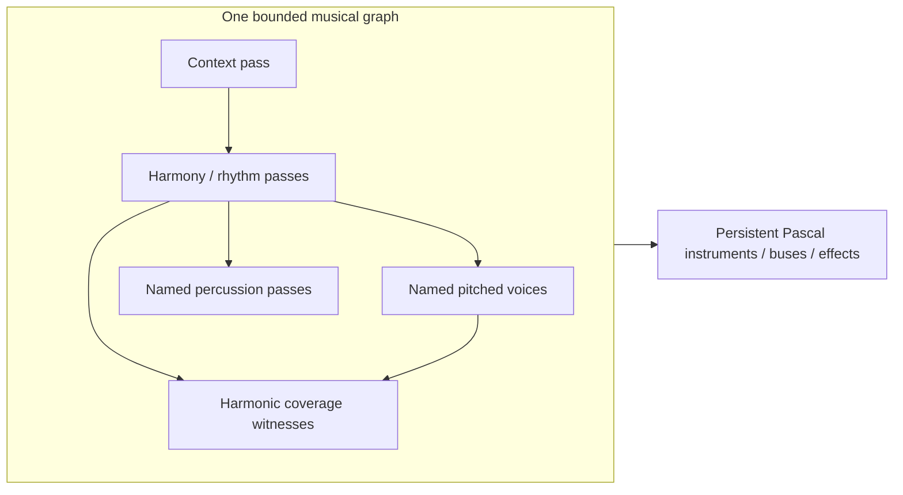

# Persistent instrumental synthesis

[Home](../README.md) · [Finite runtime](INSTRUMENTAL.md) ·
[Stream task — DONE](TODO/DONE/NS-6_instrumental-streams_01.md) · [Studio](OPERATOR-STUDIO.md)

The library and deployed Studio use bounded WFC-to-instruments streaming.
**Studio accepts2seconds–24hour plans**, defaulting to two minutes, with seven-file
output estimates and disk admission. An actual learned hour completes and plays/
seeks in the browser with its retained original provider/seed. Ordinary two-minute
generation, close/reopen and24hour admission/cancel also pass. A complete24hour
render and recording-derived style quality are not claimed. The standalone
example below uses explicitly authored material.

## Musical graph and performance



Each musical window defaults to **16 time cells**, each half a quarter note.
Version5 puts context, harmony, rhythm, ordered pitched roles, percussion and
harmonic coverage proofs in the companion's primary joint voices graph.
Each pass has the current window's `N × 1 × 1` shape; vocabulary sizes and
coverage-pass counts come from the actual models. Each drum is a named auxiliary
sequence pass constrained by the same rhythm and its declared hit preferences.
Known full-window restrictions propagate backward and forward before upstream
choices. Temporal propagation, graph compilation and binary arc support are
owned by primary WFC. There is no source-grain renderer or copied solver.

`TInstrumentalMusicStream` in `pythian.wfc.instrumental.stream` reuses the
companion's composed voices stream. Models and pitched
instruments are borrowed; the stream owns its percussion recipes. Only one
private planning window, one shared model frontier and explicit future constraints
are retained. Only the returned prefix commits; all provisional suffix choices
are discarded together. Sparse future edits cannot change committed cells.
The runtime/schema version, seed, segmentation, clock, context binding, models
and recipes define replay. Fresh choices can change across runtime versions;
previous recordings, decision journals and their actual lineage remain preserved.

The new integration passes the original192cell free-form request on native and
actual pas2js with unchanged seed and search limits. Ordinary Studio qualification
and checked deployment remain with [unguided form](TODO/NS-4_unguided-form_01.md).

Context binding is explicit. `icbAllRoles`, the streaming default, retains the
joint context's complete symbolic role choices while WFC chooses its path and
the role graphs authenticate their own paths. `icbDrivenRole` constrains H/R and
the selected role while other roles remain free. An authored context with no
selected motif has driven role−1 and binds H/R only in that mode. These frontiers can reach
incompatible continuations; small-window failures are retained evidence, not
hidden by restarting notes or looping audio. Neither mode promises arbitrary
future solvability. Finite context behavior retains its selected-role contract.

Earlier version2 added explicit structural support for the requested remainder to context
and percussion segment exits. The generic capacity/endpoint contract lives in
the separate WFC repository; musical clock/binding policy stays here. This avoids
an unsupported terminal branch when a continuing alternative exists. It does not
predict future caller masks or make a finite source cyclic. Actual source model,
seed, policy, instrument settings and requested/completed receipts remain saved.

The portable `TInstrumentMusicStream` in `pythian.music.stream` has no WFC, browser,
file or playback-device dependency. It admits native rest/attack/hold frames into
the primary scheduler and instrument planner. Holds retain the actual sources,
oscillators, envelopes and effect history. Drum bindings are natural one-shots;
a later rest does not choke them. Each PCM pull is at most 2,048 stereo frames
and obeys the primary weighted-work bound. Music/tail extents each have a one-day
bound. Pause freezes state; Stop discards future output.

`ReadOutputs` pulls the same performance into the mix and requested bus taps.
The primary bus publishes detached post-effect/post-fader blocks only after a
whole successful frame; failure invalidates them. Native Studio routes six stem
buses and one mix through seven bounded PCM16 writers, rather than rendering the
same music seven times. All seven finite output hashes match the previous path.
The shared WAV size calculator selects RIFF/RF64 from the exact extent without
allocating payload storage. File size grows with duration; working state does not.

Shared chord validation replaces the preview's duplicate validator. Shared
scheduler batch admission stages every new source before releasing predecessors;
failed preparation/cancellation leaves existing sound intact. Processing or
post-render observation failure is terminal and returns no partial failed block.
The adapter also treats failed future planning as terminal. Previously returned
PCM remains identified by `Position`.

## Native caller

Compile `examples/pythian.example.instrumental.stream.lpr` with `src`,
`adapters/wfc` and `vendor/wfc/src` on the unit path. Supply explicit `-FU` and
`-FE` directories outside the checkout. Run:

```text
pythian.example.instrumental.stream OUTPUT.wav [SECONDS [SEED [BPM]]]
```

Defaults are 120 seconds, seed731 and120BPM, plus one second of release/effects.
Durations1–86,400 seconds and40–240BPM are accepted. The primary PCM16 writer
selects RIFF/RF64 for the declared extent. Output disk use grows with duration;
graph and PCM working storage do not. The JSON sidecar retains settings and
actual provider model texts. It describes this versioned authored example;
it is not a complete general-purpose instrument/style archive.

Native and actual pas2js fixtures exercise continuous note/echo performance,
pull-partition replay, layered admission failure, pause/stop/cancellation,
planning cancellation, partial final cells and24-hour clocks. Same-target
sample replay is exact; these fixtures do not claim identical native/JS WAV
bytes. `tools/check-synthesis-portability.ps1 -IncludeWfc` adds the WFC consumer
to the core portability checks. The maintained native build runs both callers.

Big Boss's earlier authored two-minute consumer produced121 seconds including its tail,
30 planning windows,608 drum hits and12 peak active voices. Its WAV is an
audition artifact, not a musical-quality verdict. That initial example required
no generic WFC change. The later learned-hour consumer exposed a real segment-exit
gap, now addressed by the separate WFC continuation branch described above.

## Accepted Studio consumer

Native playlist jobs learn actual selected music and retain source/model/seed,
runtime version, requested/completed clocks, graph schema and instrument recipes.
The previously failed hour now completes14400cells in900windows and86424000frames
including its1second tail. It produced a3601second mix and six matching stems,
each345696044bytes. Browser playback seeks near the hour end without buffering
the entire WAV. The synthetic fixture has five peak voices and one drum hit;
this verifies execution, not musical richness.

The ordinary two-minute UI job reopens after tab closure and restores the same
request. Final saving closes8/8 atomically with job success. An actual24hour
request is admitted with the displayed54.07GiB seven-file estimate and cancels
without publishing a successful review. Its I/O-blocked worker needed the owned
supervisor's five-second grace stop; cancellation is checkpoint-based.
All five [WFC CI62 jobs](https://github.com/mr-highball/wfc/actions/runs/41189435399)
and [Pythian CI519](https://github.com/mr-highball/pythian/actions/runs/41189774156)
pass, alongside native/actual pas2js replay, continuation and failure checks.
Evidence is retained under the dedicated E-drive `studio-long-20261031-boss` and
`sequence-continuation-20261031-boss` packets. Big Boss performed these solo checks.
